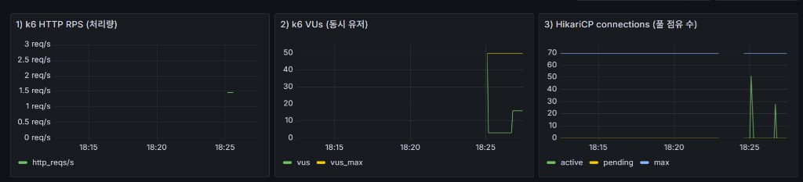
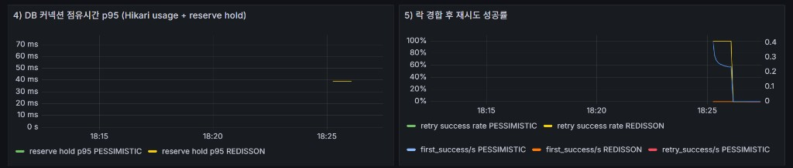
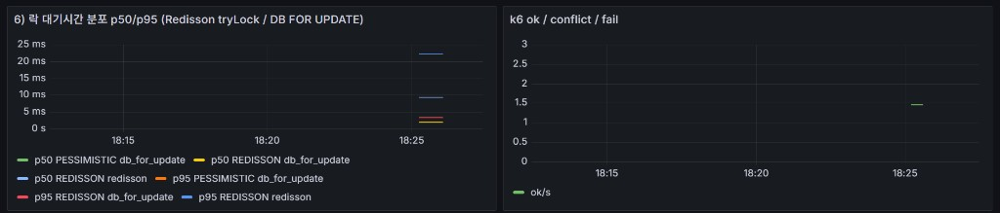
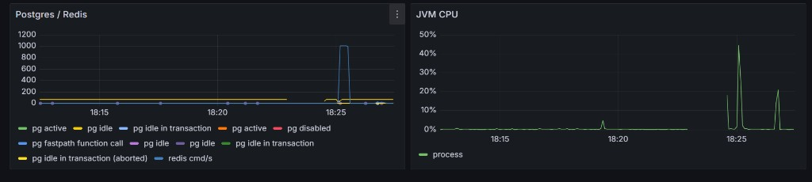

# EvCharge (`ev`)

전기차 충전소 **조회 · 자동예약 · 즐겨찾기** Spring Boot 애플리케이션입니다.  
동시 예약 경합에서 **이중 예약을 막고**, **비관적 락(DB `FOR UPDATE`) vs Redisson 분산 락**을 런타임에 전환·비교할 수 있습니다.

이 파일 하나에 **실행 안내 · 모니터링 · 부하 테스트 보고서**를 모았습니다.

## 목차

1. [스택](#스택)
2. [사전 준비](#사전-준비)
3. [환경 변수](#환경-변수-env)
4. [실행 방법](#실행-방법)
5. [폴더 안내](#폴더-안내)
6. [모니터링 (Prometheus + Grafana)](#모니터링-prometheus--grafana)
7. [동시성 · 락](#동시성--락-요약)
8. [CI](#ci)
9. [부하 테스트 빠른 실행](#부하-테스트-빠른-실행)
10. [부하 테스트 결과 보고서](#부하-테스트-결과-보고서)

---

## 스택

| 구분 | 기술 |
|------|------|
| App | Java 17, Spring Boot 4, Security(세션), JPA, Thymeleaf |
| DB / Cache | PostgreSQL 16, Redis 7 (Redisson) |
| 외부 API | 카카오맵 JS · 카카오 REST/Mobility · 공공데이터 충전소 |
| 부하 테스트 | k6 (`loadtest/`) |
| 모니터링 | Prometheus + Grafana (`monitoring/` 설정) |

---

## 사전 준비

- Java 17+
- Docker Desktop
- Gradle Wrapper (`gradlew` / `gradlew.bat`)
- (부하 테스트 시) [k6](https://k6.io/)

---

## 환경 변수 (`.env`)

시크릿은 커밋하지 않습니다. **`.env.example`을 복사해 `.env`를 만들고** 값을 채우세요.

```powershell
# Windows · ev 폴더
copy .env.example .env
```

```bash
# macOS/Linux
cp .env.example .env
```

| 변수 | 용도 |
|------|------|
| `KAKAO_MAPS_API_KEY` | 카카오맵 JavaScript 키 |
| `KAKAO_REST_API_KEY` | 카카오 REST / Mobility |
| `PUBLIC_DATA_API_KEY` | 공공데이터 충전소 API |
| `DB_PASSWORD` | PostgreSQL (`docker-compose` · 앱 공통) |
| `SESSION_COOKIE_SECURE` | HTTPS면 `true` (로컬 `false`) |
| `GRAFANA_ADMIN_USER` / `PASSWORD` | Grafana 로그인 (기본 `admin`/`admin`) |

`application.yml`은 `${KAKAO_MAPS_API_KEY:}` 형태로만 참조합니다.  
로컬에서는 `springboot4-dotenv`가 `.env`를 로드하고, Cursor는 `.vscode/launch.json`의 `envFile`도 사용합니다.

---

## 실행 방법

**위치: `ev` 폴더**

### 1) 인프라

```powershell
docker compose up -d
```

기동: Postgres, Redis, Prometheus, Grafana, exporters

DB·Redis만 켤 때:

```powershell
docker compose start postgres redis
# 끌 때 (컨테이너 유지): docker compose stop postgres redis
```

### 2) 앱

```powershell
.\gradlew.bat bootRun
```

또는 Cursor **Run and Debug → EvApplication**

### 3) 접속

| URL | 용도 |
|-----|------|
| http://localhost:8080 | EvCharge 앱 |
| http://localhost:3000 | Grafana (`admin` / `admin`) |
| http://localhost:9090 | Prometheus |

---

## 폴더 안내

| 경로 | 역할 |
|------|------|
| `README.md` | **이 문서** (실행 + 모니터링 + 부하 테스트 보고서) |
| `loadtest/` | k6 스크립트, SQL, 스크린샷 |
| `monitoring/` | Prometheus/Grafana **설정 파일** (대시보드 JSON 등) |
| `docs/` | 리팩터링·설계 메모 |
| `src/` | 애플리케이션 코드 |

---

## 모니터링 (Prometheus + Grafana)

```
k6 ──(remote write)──► Prometheus ◄── scrape ── Spring Actuator / exporters
                              │
                              ▼
                           Grafana
```

| 서비스 | URL | 역할 |
|--------|-----|------|
| Grafana | http://localhost:3000 | 대시보드 (기본 `admin` / `admin`) |
| Prometheus | http://localhost:9090 | 메트릭 저장 + k6 remote write 수신 |
| postgres-exporter | :9187 | DB 커넥션 등 |
| redis-exporter | :9121 | Redis commands / clients |
| Spring Actuator | http://localhost:8080/actuator/prometheus | Hikari·JVM |

대시보드: Grafana → **EV Charge / EV Loadtest Overview**  
(공식 k6 대시보드 Import: ID `18030`)

설정 파일: `monitoring/prometheus/`, `monitoring/grafana/`  
앱 메트릭은 Prometheus가 `host.docker.internal:8080`으로 scrape 합니다.

k6 → Prometheus (권장):

```powershell
.\loadtest\run-with-grafana.ps1 -Strategy REDISSON -Script auto-reserve-50slots.js -MaxKm 1
```

로컬 전용으로 `/actuator/prometheus`, `/api/admin/lock-strategy` 는 인증 없이 열려 있습니다. **배포 시 반드시 막으세요.**

---

## 동시성 · 락 (요약)

| 항목 | 내용 |
|------|------|
| 점유 TX | `reserveCharger` → `REQUIRES_NEW` + `FOR UPDATE` fresh read |
| 자동예약 | 오케스트레이션 `NOT_SUPPORTED`, **409면 다음 후보 폴백** |
| Redisson | 커밋/롤백 후 unlock (`afterCompletion`) |
| DB 방어 | `UNIQUE (charger_id) WHERE status = 'PENDING'` |
| 전략 전환 | `POST /api/admin/lock-strategy` `{ "strategy": "REDISSON" \| "PESSIMISTIC" }` |

---

## CI

GitHub Actions (`.github/workflows/ci.yml`): Postgres + Redis 서비스 컨테이너, Secrets로 API 키·`DB_PASSWORD` 주입 후 `./gradlew build`.

---

## 부하 테스트 빠른 실행

목적: 이중 예약 검증 · REDISSON vs PESSIMISTIC · Grafana 수치화

| 파일 | 설명 |
|------|------|
| `loadtest/auto-reserve-50slots.js` | 50 VU · 마지막 성공 시각 |
| `loadtest/run-with-grafana.ps1` | k6 → Prometheus remote write |
| `loadtest/prepare-50-slots.sql` / `reset-…` | 자리 고정 · 리셋 |
| `loadtest/COMPARE-50SLOTS.md` | 체크리스트 |
| `loadtest/screenshots/` | Grafana 캡처 |

```powershell
docker cp loadtest/prepare-50-slots.sql ev-charge-db:/tmp/p50.sql
docker exec ev-charge-db psql -U ev_admin -d ev_charge -f /tmp/p50.sql

.\loadtest\run-with-grafana.ps1 -Strategy REDISSON -Script auto-reserve-50slots.js -MaxKm 1

docker cp loadtest/reset-loadtest-reservations.sql ev-charge-db:/tmp/reset.sql
docker exec ev-charge-db psql -U ev_admin -d ev_charge -f /tmp/reset.sql
docker exec ev-charge-db psql -U ev_admin -d ev_charge -f /tmp/p50.sql
.\loadtest\run-with-grafana.ps1 -Strategy PESSIMISTIC -Script auto-reserve-50slots.js -MaxKm 1
```

---

## 부하 테스트 결과 보고서
작성일: 2026-09-10  
대상 프로젝트: `ev` (Spring Boot + PostgreSQL + Redis/Redisson)  
측정 도구: k6 v2.x, Docker (`ev-charge-db`, `ev-redis`)

---

## 1. 목적

1. 자동예약(`POST /api/reservations/auto`) 동시 요청에서 **이중 예약**이 발생하는지 검증한다.
2. **비관적 락(DB `FOR UPDATE`)** 과 **Redisson 분산 락**을 비교한다.
3. 결함 수정·409 폴백 적용 후, **성공률·지연·DB 불변조건**이 어떻게 바뀌는지 수치로 남긴다.
4. 자리 수 = 유저 수(50)인 경합에서 **마지막 성공 예약까지 걸린 시간**을 측정한다.

---

## 2. 공통 실험 조건

| 항목 | 값 |
|------|-----|
| 가상 사용자(VU) | loadtest 유저 (초기 10 → 이후 **50**) |
| 비밀번호 | `test1234` (로그인 username = email) |
| 좌표 | 서울시청 인근 `37.566826`, `126.9786567` (k6 스크립트 고정값, 브라우저 GPS와 무관) |
| 반경 | `maxDistanceKm` **0.5** 또는 **1.0** |
| 앱 | `8080` / `8081` 듀얼 또는 단일 `8080` |
| Redis | `localhost:6379` (`ev-redis`) |
| DB | PostgreSQL `ev_charge` (`ev-charge-db`) |
| 스크립트 | `loadtest/auto-reserve.js`, `loadtest/auto-reserve-50slots.js` |

### 2.1 시드·준비 SQL

| 파일 | 역할 |
|------|------|
| `seed-loadtest-users-10.sql` / `seed-loadtest-users-50.sql` | 테스트 유저·차량 생성 |
| `reset-loadtest-reservations.sql` | loadtest PENDING 취소·충전기 AVAILABLE 복구 |
| `prepare-50-slots.sql` | 유저 차종 통일 + AVAILABLE **50기** 고정 |

---

## 3. 발견한 핵심 결함 (이중 예약)

### 3.1 현상 (수정 전, 충전소 5곳 한정 · VU 50 · REDISSON/PESSIMISTIC)

**k6 HTTP 지표만 보면 “전부 성공”처럼 보임.**

| 전략 | ok | conflict | fail |
|------|---:|---------:|-----:|
| REDISSON | **50** | 0 | 0 |
| PESSIMISTIC | **50** | 0 | 0 |

**DB 실측은 불변조건 위반.**

| DB 지표 | 값 |
|---------|-----|
| PENDING 건수 | 50 |
| DISTINCT `charger_id` | **6** |
| **한 충전기당 최대 PENDING** | **20** (예: `charger_id=135049`) |

→ API는 201을 반환했지만, **충전기 1기 = PENDING 1건** 규칙이 깨짐.

### 3.2 원인 요약

| # | 원인 | 설명 |
|---|------|------|
| 1 | 긴 `@Transactional` + L1 캐시 | `autoReserve`에서 후보를 `AVAILABLE`로 로드한 뒤, 같은 TX의 `findById`가 **stale status**로 가드 |
| 2 | Redisson unlock 타이밍 | `finally` unlock이 **DB 커밋보다 앞설 수 있음** (TOCTOU) |
| 3 | DB 최후 방어 부재 | `charger_id`당 PENDING 1건을 강제하는 제약 없음 |

### 3.3 교훈

> 부하 테스트는 **HTTP 성공률만으로 판단하면 안 된다.**  
> `GROUP BY charger_id HAVING count(*) > 1` 같은 **DB 불변조건 검증**이 필수다.

---

## 4. 코드 수정 내역

### 4.1 정합성 (이중 예약 방지)

| 수정 | 내용 |
|------|------|
| `ReservationService.reserveCharger` | `propagation = REQUIRES_NEW` — 후보조회 TX와 분리 |
| 상태 재조회 | 락 후 `findByIdForUpdate`로 **fresh** 읽기 |
| 가드 강화 | 동일 충전기 `PENDING` 존재 시 409 |
| `RedissonLockStrategy` | unlock을 `TransactionSynchronization.afterCompletion`으로 **커밋/롤백 이후** |
| DB | `UNIQUE (charger_id) WHERE status = 'PENDING'` (`uq_reservations_charger_pending`) |
| Hikari / Postgres | 풀·`max_connections` 상향 (동시 FOR UPDATE 대기 대비) |

### 4.2 UX·처리량 (409 폴백)

| 수정 | 내용 |
|------|------|
| `AutoReservationService` | `reachable` 순회, **409면 다음 후보** 시도 |
| 오케스트레이션 TX | `NOT_SUPPORTED` — Kakao/폴백 루프가 커넥션을 오래 붙잡지 않음 |

### 4.3 부하 측정용 옵션

| 설정 | 의미 |
|------|------|
| `loadtest.skip-kakao: true` | 순위만 직선거리 (락·폴백·예약 로직은 동일). 50 동시 Kakao 호출 병목 회피 |

---

## 5. 수치 변화 타임라인

실험 축: **VU 50 · 반경 0.5~1km · 핫스팟(AVAILABLE 제한)**  
비교 단위: k6 카운터 + DB `max(PENDING per charger)`.

### 5.1 단계 A — 수정 전 (이중 예약)

| 지표 | REDISSON | PESSIMISTIC |
|------|---------:|------------:|
| ok | 50 | 50 |
| conflict | 0 | 0 |
| fail | 0 | 0 |
| **max PENDING / charger** | **20** | **20** (동일 패턴) |
| DISTINCT chargers (PENDING) | 6 | 6 |

### 5.2 단계 B — 정합성만 수정 (폴백 없음)

| 지표 | REDISSON | PESSIMISTIC |
|------|---------:|------------:|
| ok | **1** | **1** |
| conflict | 3 | 11 |
| fail | 46 | 38 |
| **max PENDING / charger** | **1** | **1** |
| dup chargers (`count>1`) | **0** | **0** |
| auto duration avg | ~26.9s | ~28.5s |

해석:
- 이중 예약 **해소**
- 전원 동일 1등 충전기만 시도 → 성공 1건, 나머지 409/404
- 락 대기로 latency 급증

### 5.3 단계 C — 폴백만 추가, 바깥 TX 미정리 (실패 런)

| 지표 | 값 |
|------|-----|
| ok | **0** |
| fail | **50** |
| duration avg | **~30.7s** |
| 서버 로그 | `HikariPool … Connection is not available, request timed out after ~30000ms` |

원인: 바깥 TX가 커넥션을 잡은 채 `REQUIRES_NEW` 반복 → **풀 고갈**.

### 5.4 단계 D — 폴백 + `NOT_SUPPORTED` + pool 보강 (REDISSON, AVAILABLE≈12 · 5곳)

| 지표 | 정합성만(B) | 폴백+TX 정리(D) |
|------|------------:|----------------:|
| ok | 1 | **6** |
| fail | 46 | 44 |
| pending | 1 | **6** |
| DISTINCT chargers | 1 | **6** |
| **max PENDING / charger** | **1** | **1** |
| duration avg | ~27s | **~11.2s** |

해석: 1등이 막히면 차순위로 넘어가 **서로 다른 6기**까지 채움. 이중 예약은 계속 0.

---

## 6. 50자리 × 50유저 — 마지막 성공까지 시간

### 6.1 설정

| 항목 | 값 |
|------|-----|
| 유저 | 50 (전원 **현대 아이오닉5**) |
| AVAILABLE | **정확히 50기** (타입 02/04, 시청 박스 내 최단거리순) |
| 전략 | REDISSON + 409 폴백 |
| 순위 | `loadtest.skip-kakao=true` (직선거리) |
| 앱 | **단일 8080** (PG `max_connections=200`, Hikari 70) |
| 스크립트 | `loadtest/auto-reserve-50slots.js` |

### 6.2 결과 (최종 성공 런)

| 지표 | 값 |
|------|-----|
| ok | **49** |
| conflict | **1** |
| fail | 0 |
| PENDING / DISTINCT charger | **49 / 49** |
| max PENDING / charger | **1** |
| **첫 성공 (start 기준)** | **2.748 s** (2,748 ms) |
| **마지막 성공 (start 기준)** | **5.688 s** (5,688 ms) |
| 첫~마지막 성공 간격 | **2.940 s** |
| 요청당 duration avg | **3.609 s** |
| 요청당 duration p95 | **4.872 s** |

해석:
- 50명이 동시에 달려들어, **마지막(49번째) 성공 확정까지 약 5.7초**.
- 1명은 자리 소진 후 409 (경합 타이밍).
- DB상 이중 예약 **0**.

### 6.3 참고: Kakao 미스킵 시

50 동시 Kakao 다중목적지 호출 + 커넥션 경합으로 ok가 11~26 수준에 머물고 duration ~30s대(타임아웃)가 관측됨.  
**락/폴백 로직 측정을 위해** 최종 50×50 런에서는 Kakao만 스킵했다.

### 6.4 Grafana 비교 런 — REDISSON vs PESSIMISTIC (2026-09-11)

동일 조건에서 락 전략만 바꿔 **수치·그래프 증거**를 남긴 런이다.

| 항목 | 값 |
|------|-----|
| 일시 | 2026-09-11 |
| VU / AVAILABLE | **50 / 50** |
| 반경 | `MAX_KM=1` |
| 앱 | 단일 `8080` |
| 모니터링 | Prometheus + Grafana (`EV Loadtest Overview`) |
| 스크립트 | `loadtest/run-with-grafana.ps1` → `auto-reserve-50slots.js` |
| 절차 문서 | `loadtest/COMPARE-50SLOTS.md` |

#### k6 결과

| 지표 | REDISSON | PESSIMISTIC |
|------|---------:|------------:|
| ok | **50** | **50** |
| conflict | 0 | 0 |
| fail | 0 | 0 |
| duration avg | **5331 ms** | **2282 ms** |
| duration p95 | **6848 ms** | **3234 ms** |
| 첫 성공 (start 기준) | 4.172 s | 1.663 s |
| **마지막 성공까지** | **8.776 s** | **4.197 s** |
| 첫~마지막 간격 | 4.604 s | 2.534 s |

#### DB 불변조건 (PESSIMISTIC 런 직후)

| 지표 | 값 |
|------|-----|
| PENDING | **50** |
| DISTINCT charger | **50** |
| max PENDING / charger | **1** |

#### Grafana에서 캡처할 패널

대시보드: http://localhost:3000/d/ev-loadtest-overview/ev-loadtest-overview  
스크린샷 저장 위치: `loadtest/screenshots/`

| # | 패널 | 의미 |
|---|------|------|
| 1 | k6 HTTP RPS | 처리량 (TPS 감) |
| 2 | k6 VUs | 동시 유저 50 |
| 3 | HikariCP connections | 풀 active / pending / max |
| 4 | DB 커넥션 점유시간 p95 | Hikari usage + `ev_reserve_hold` |
| 5 | 락 경합 후 재시도 성공률 | `retry_success / (retry_success + exhausted)` |
| 6 | 락 대기시간 p50/p95 | Redisson tryLock / DB `FOR UPDATE` |

#### Grafana 스크린샷 (2026-09-11 비교 런)

**1~3) RPS · VU · Hikari**



- VU **50** 스파이크 확인
- Hikari **active ≈ 50~51**, **pending = 0**, max **70** → 풀 고갈 없음
- RPS는 short spike 특성상 낮은 구간값(~1.5)으로 보이며, **총량 비교는 위 k6 표(ok/duration)가 기준**

**4~5) 커넥션 점유시간 · 재시도 성공률**



- REDISSON `reserve hold` p95 ≈ **40 ms** 구간 관측
- REDISSON 내부 폴백 경로에서 **retry success rate ≈ 100%** (경합 후 다음 후보 성공)
- PESSIMISTIC은 본 런에서 클라이언트 최종 409가 없어 재시도율 곡선이 거의 안 보임(대부분 1차 성공 성격)

**6) 락 대기시간 · k6 ok**



| 구분 | 대략값 (그래프) |
|------|-----------------|
| REDISSON tryLock p95 | **~22 ms** |
| REDISSON tryLock p50 | **~9 ms** |
| REDISSON 경로의 `FOR UPDATE` p95 | **~3 ms** |
| PESSIMISTIC `FOR UPDATE` | **~1~2 ms** (낮음) |
| k6 ok/s (순간) | ~1.5 |

→ 단일 인스턴스에서 **락 대기 자체는 Redisson tryLock이 DB FOR UPDATE보다 큼**.

**Postgres / Redis · JVM CPU**



- REDISSON 런 시각에 **redis cmd/s ≈ 1000** 스파이크
- JVM process CPU 피크 ≈ **45%** (이어서 PESSIMISTIC 구간에서 더 낮은 피크)
- Postgres는 idle 위주, active 폭주 없음 (풀·락 정리 후 안정)

부가 캡처(REDISSON 진행 중): `01b`~`04b` 동일 폴더.

#### 해석

- 자리 수 = 유저 수(50)인 **여유 있는 경합**에서는 두 전략 모두 **ok 50 · 이중 예약 0**.
- 동일 조건에서 **완료 지연은 PESSIMISTIC이 더 짧음** (마지막 성공 4.2s vs 8.8s).
- Redisson은 분산 락(tryLock wait + Redis 왕복) 비용이 단일 인스턴스·단일 DB 경합에서는 오버헤드로 나타날 수 있다.
- **멀티 인스턴스(8080+8081)** 에서는 Redisson의 장점(인스턴스 간 락)이 드러나므로, 단일 인스턴스 지연만으로 “항상 Redisson이 느리다”고 단정하지 않는다.
- 핫스팟(AVAILABLE ≪ VU) 시나리오의 409 폴백·성공률 차이는 §5·§6.2를 참고.

---

## 7. 한눈에 보는 전체 변화

```
[수정 전]
  k6: ok 50 / conflict 0
  DB: 충전기 1기당 PENDING 최대 20     ← 사고

[정합성 수정]
  k6: ok 1 / conflict·fail 다수
  DB: 충전기당 PENDING 최대 1          ← 안전, UX 부족

[폴백 + 오케스트레이션 TX 제거]
  k6: ok 6 (핫스팟 12기 중 호환분)
  DB: PENDING 6기, max 1               ← 안전 + 차선 예약

[50자리 × 50유저]
  k6: ok 49 / conflict 1
  마지막 성공까지 ≈ 5.7초
  DB: max PENDING/charger = 1
```

---

## 8. 재현 방법 (요약)

**위치: PC PowerShell · `ev` 폴더**

```powershell
# 0) 모니터링 스택
docker compose up -d
# Grafana: http://localhost:3000  (admin/admin)
# Prometheus: http://localhost:9090

# 1) DB 준비 (Docker · 파일 복사 권장 — 한글 SQL 인코딩)
docker cp loadtest/prepare-50-slots.sql ev-charge-db:/tmp/p50.sql
docker exec ev-charge-db psql -U ev_admin -d ev_charge -f /tmp/p50.sql

# 2) 앱 (예시: 8080)
.\gradlew.bat bootRun --args="--server.port=8080"

# 3) k6 + Grafana remote write (전략별)
.\loadtest\run-with-grafana.ps1 -Strategy REDISSON -Script auto-reserve-50slots.js -MaxKm 1
# 리셋 후
docker cp loadtest/reset-loadtest-reservations.sql ev-charge-db:/tmp/reset.sql
docker exec ev-charge-db psql -U ev_admin -d ev_charge -f /tmp/reset.sql
docker exec ev-charge-db psql -U ev_admin -d ev_charge -f /tmp/p50.sql
.\loadtest\run-with-grafana.ps1 -Strategy PESSIMISTIC -Script auto-reserve-50slots.js -MaxKm 1

# 4) DB 불변조건
docker exec ev-charge-db psql -U ev_admin -d ev_charge -c "
SELECT count(*) AS pending,
       count(DISTINCT charger_id) AS chargers,
       coalesce(max(cnt),0) AS max_per
FROM (
  SELECT charger_id, count(*) cnt
  FROM reservations r
  JOIN users u ON u.id = r.user_id
  WHERE u.email LIKE 'loadtest%' AND r.status = 'PENDING'
  GROUP BY charger_id
) t;"
```

상세 체크리스트: `loadtest/COMPARE-50SLOTS.md`

---

## 9. 결론

1. **HTTP ok 50 ≠ 정합성 확보.** 수정 전 max PENDING/charger = **20**.
2. `REQUIRES_NEW` + `FOR UPDATE` fresh read + 커밋 후 Redis unlock + partial unique로 **max PENDING/charger = 1** 달성.
3. 409 폴백으로 핫스팟에서 성공이 **1 → 6**(제한된 AVAILABLE)으로 증가, 50×50에서는 **49 성공**(초기 런) / Grafana 비교 런에서는 **양쪽 50 성공**.
4. 50자리 경합에서 **마지막 성공까지** — 초기 REDISSON 약 **5.7초**, Grafana 비교 런에서는 REDISSON **8.8초** / PESSIMISTIC **4.2초**.
5. 자동예약 오케스트레이션은 **긴 TX를 열지 않는 것**이 커넥션 풀·락 대기 안정성에 중요했다.
6. **단일 인스턴스 50×50**에서는 PESSIMISTIC이 지연면에서 유리했고, Redisson 가치는 **멀티 인스턴스 분산 락** 시나리오에서 별도 증명하는 것이 맞다.

---

## 10. 관련 파일

| 경로 | 설명 |
|------|------|
| `src/main/java/.../service/ReservationService.java` | REQUIRES_NEW, FOR UPDATE 예약 |
| `src/main/java/.../service/AutoReservationService.java` | NOT_SUPPORTED, 409 폴백, skip-kakao, 재시도 메트릭 |
| `src/main/java/.../lock/RedissonLockStrategy.java` | afterCompletion unlock, 락 대기 메트릭 |
| `src/main/java/.../lock/LockMetrics.java` | Prometheus용 락/재시도/점유 메트릭 |
| `src/main/resources/application.yml` | redis, hikari, actuator, `loadtest.skip-kakao` |
| `loadtest/auto-reserve.js` | 일반 A/B 부하 |
| `loadtest/auto-reserve-50slots.js` | 50자리 마지막 성공 시각 측정 |
| `loadtest/run-with-grafana.ps1` | k6 → Prometheus remote write |
| `loadtest/COMPARE-50SLOTS.md` | Grafana 비교 실행 절차 |
| `loadtest/screenshots/` | 본 보고서 첨부 그래프 |
| `monitoring/` | Prometheus / Grafana 설정 파일 |
| `docker-compose.yml` | postgres, redis, prometheus, grafana, exporters |
